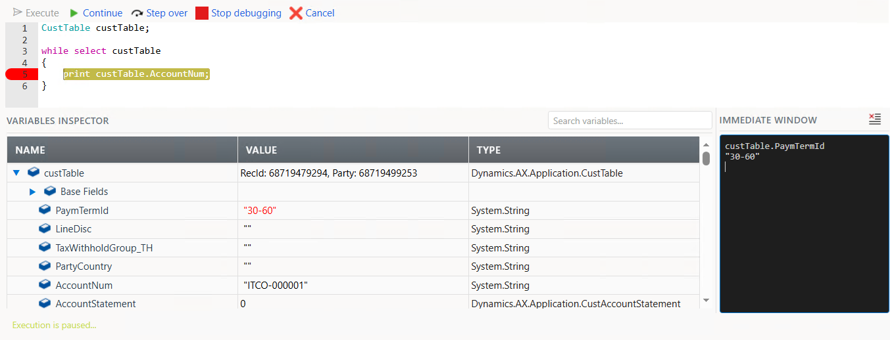

<h1 align="center">MXT - X++ Interpreter</h1>

> **Important:** This is an interactive runtime X++ execution engine, not a replacement for the native X++ compiler. Interpreted code runs with the current user's X++ and CLR privileges and is not sandboxed. Use it only in controlled development or diagnostic environments.

This tool lets you write, execute, and debug X++-style scripts directly in the browser without compiling a model or restarting the service.

## Getting started
1. Clone the repo
2. Execute `Initialize.ps1` script as *Administrator*. This will create a symbolic link into your *LocalPackageDirectory*
3. Build and synchronize the **MXppTools** model
4. Navigate to System Administration > Workspaces > **MXT - X++ Interpreter**

## Fast resident AOS execution

`MXTXppInterpreterServiceGroup` exposes a rollback-only JSON custom service that calls the already-loaded interpreter inside the current AOS request. Editing and running a script through this endpoint does **not** invoke `xppc.exe`, build a package, synchronize the database, restart AOS, or submit a SysTest job.

The native MXppTools host is compiled and deployed once. After that, run source directly:

```powershell
.\Scripts\Invoke-MXTXppFast.ps1 `
    -SourceCode 'int value = 1; value += 41; info(strFmt("Value: %1", value));' `
    -Warmup 2 `
    -Iterations 20
```

On a configured Unified developer workstation, the client resolves the linked Finance and Operations URL through Dataverse and obtains an OAuth token from the signed-in Azure CLI account. `-EnvironmentUrl` and `-AccessToken` can be supplied explicitly for other clients. The endpoint is:

```text
/api/services/MXTXppInterpreterServiceGroup/MXTXppInterpreterService/execute
```

The response includes success/error, infolog output, instruction count, rollback status, and server-side parse, bytecode-generation, execution, and total timings in microseconds. Every call enforces the existing interpreter security check and the `MXTXppInterpreterFastExecute` service-operation privilege. Database work is always wrapped in an interpreter-owned TTS scope and aborted before the response; external side effects are not reversible.

Measured against a Unified AOS environment on 2026-09-03:

| Scenario | HTTP P50 | Server total (sample) |
| --- | ---: | ---: |
| Small edit-to-result | 156.5 ms | 13.5 ms |
| Native `UserInfo` ORM query | 167.1 ms | 47.1 ms |
| 1,000-iteration interpreted loop | 200.2 ms | 49.7 ms |
| Runtime table: 100 inserts plus query | 195.6 ms | 235.3 ms |

The server column is a single returned sample; the HTTP percentiles are measured across repeated requests. The deployment helper for a Unified development environment is `Scripts\Deploy-MXTXppUdeModule.ps1`.

### Durable interpreted modules

The resident service also contains a schema-free module registry. Source is stored as immutable, named versions in the existing D365FO `SysLastValue` document store; the active version is compiled to bytecode and cached inside each AOS process. An AOS recycle clears only the bytecode cache—the next execution rebuilds it from the persisted source. Creating or changing an interpreted module therefore requires no X++ package build, database synchronization, or AOS restart.

Deploy and activate version 1:

```powershell
.\Scripts\Invoke-MXTXppModule.ps1 Deploy `
    -ModuleName Demo.Calculation `
    -SourceCode 'info("version 1");'
```

Dependencies are pinned when a version is staged. `-Dependency Common.Library` pins its active version; `-Dependency Common.Library@2` pins version 2 explicitly.

```powershell
.\Scripts\Invoke-MXTXppModule.ps1 Execute -ModuleName Demo.Calculation -Warmup 1 -Iterations 10
.\Scripts\Invoke-MXTXppModule.ps1 Get -ModuleName Demo.Calculation
.\Scripts\Invoke-MXTXppModule.ps1 List
.\Scripts\Invoke-MXTXppModule.ps1 Rollback -ModuleName Demo.Calculation
```

`Deploy` activates by default. Use `-Activate:$false` to stage a version, validate it separately, and later run `Activate -ModuleName Name -Version N`. Activation compiles the complete pinned dependency graph before changing the active pointer, so a validation or compilation failure leaves the previous version live. `Execute` remains rollback-only for database work, including execution of a specifically requested staged version.

The durable module endpoints are `deployModule`, `activateModule`, `rollbackModule`, `executeModule`, `getModule`, and `listModules` under the same authenticated service URL. Module management commits only registry metadata; interpreted business code is still executed inside the bounded 30-second rollback scope.

## Interpreter

The parser generates bytecode for a hybrid runtime. Existing application classes, AOT metadata, `Common` buffers, SysDa queries, transactions, and CLR types execute through X++ host proxies. Script-declared code and runtime artifacts execute in the interpreter. The query router selects the native or interpreted relational engine from the actual buffer, so both kinds can coexist in one script.


### Code editor

The editor highlights reserved words, reports parse errors, and indicates the current statement while debugging.

Some keyboard shortcuts are implemented to easily execute, insert a breakpoint, step over and continue debugging. These can be found as standard shortcuts by Right click > View shortcuts on the editor.


The variable inspector will allow you to take a look to the variables that are currently on scope and will let you modify the values for primitive types. Using the immediate window, you will be able to execute X++ expressions while debugging.


### Script repository

You can save X++ scripts into the built-in repository to later execute them.


## Use cases

* Execute, modify, and save diagnostic scripts
* Experiment with application APIs and metadata
* Test method-sized pieces of logic without a model build
* Inspect class, table, label, and enum metadata

## Security

Every parse and execution entry point requires a System administrator. On a non-development environment the user must also have the **MXT Script executor** role. Script execution is logged unless the development-environment no-log option is enabled.

The interpreter is not a security boundary: a script can invoke arbitrary accessible X++ and CLR APIs in the AOS process. Instruction, loop, and elapsed-time limits protect interpreter checkpoints, but they cannot pre-empt a single native call before that call returns. Global transaction isolation is enabled by default and aborts an interpreter-owned transaction at the end of a run; it does not undo external side effects such as messages, files, or services.

## Language support

* **Macros**: `#define`, `#globaldefine`, `#undef`, `#if` / `#ifnot` / `#endif`, `#localmacro` / `#macro` ... `#endmacro` with `%1..%n` parameters, `#defInc` / `#defDec`, `#linenumber`, and `#macrolib`. The D365FO host resolves macro dictionaries from `PackagesLocalDirectory`; recursive definitions are rejected.
* **Class declarations**: access modifiers, instance/static/const fields, constructors, `TypeNew`, optional literal-default parameters, abstract/final/static classes and methods, inheritance, virtual dispatch, `super()`, script and compiled interfaces, delegates, event handlers, attributes, and signature/access validation. An interpreted class implementing a compiled interface is emitted as a real CLR/AOS interface instance; native callbacks dispatch into the interpreted method and `ref`/`out` changes copy back to the compiled caller.
* **Script class augmentation and Chain of Command**: `[ExtensionOf]` classes can add instance/static methods and state to script-declared or compiled AOS classes/tables, and wrap their public/protected methods with `next`. Compiled target signatures are read through the unified SysDict/CLR descriptor layer; the real AOS method is the terminal implementation. `[Hookable]`, `[Wrappable]`, and `[Replaceable]` rules are enforced, including current `next` placement rules and `try/catch/finally` support.
* **Attributes, events, and hooks**: attributes on types, fields, methods, and delegates are retained as runtime metadata. Runtime adapters bind `[SubscribesTo]`, `[DataEventHandler]`, `[FormEventHandler]`, `[FormControlEventHandler]`, `[FormDataSourceEventHandler]`, and `[FormDataFieldEventHandler]`; `[PreHandlerFor]` and `[PostHandlerFor]` wrap calls that cross the interpreter/AOS dispatcher.
* **Extending compiled X++ classes**: a genuine CLR subclass of the compiled base is emitted at runtime (Reflection.Emit) with overrides that dispatch into the script methods — so **compiled-side virtual calls (template methods, callbacks) reach script overrides**, and script instances can be passed to any compiled API expecting the base type; unknown members and `super()` forward to the base implementation. When the base cannot be subclassed (sealed / no reachable constructor), it falls back to wrapping with member forwarding.
* **.NET interop**: `using Some.Namespace;` imports and `using Alias = ...;` aliases, namespace-qualified types in declarations, `new`, `::` static calls, `is` / `as`, `byref` for CLR and interpreted method/function copy-out, array parameters, `params`-array expansion, and overload selection that never silently truncates reals.
* **Data and transaction statements**: `select`, select expressions, `while select`, `insert_recordset`, `update_recordset`, `delete_from`, joins, grouping, aggregates, ordering, cross-company/valid-time filtering, `changeCompany`, `ttsBegin`, `ttsCommit`, and `ttsAbort`. Native buffers lower through SysDa; runtime buffers use the interpreted relational engine with transaction snapshots.
* **Executable runtime artifacts**: attributes turn ordinary interpreted classes into tables, data entities, views, form controllers, reports, services, and maps. `[RuntimeTable]` provides automatic typed buffers, `[RuntimeKey]`, generated `RecId`, row methods (`insert`, `update`, `delete`, `write`, `reread`, `clear`), and set-based queries. `[RuntimeDataEntity(Table)]` and `[RuntimeView(Table)]` project the same runtime storage, with views enforced read-only. Forms/reports/services/maps retain interpreted state and methods and execute through the same model registry.
* **AOS and runtime metadata intrinsics**: compile-time functions validate against either installed AOT metadata or the interpreted descriptor graph. Runtime artifacts support stable non-colliding IDs and strings for tables, fields, indexes, field groups, methods, form data sources/controls/methods, entities, views, services, and service operations.
* **X++ semantics**: integer `div`, true `switch` fall-through, extension-method resolution, soft keywords as identifiers, hex/exponent/`utcdatetime`/verbatim literals, sized strings, mixed array declarators, and `like` declarations.
* **Compatibility syntax**: `client`/`server` and `display`/`edit` modifiers are accepted. They do not create a different execution tier or UI binding in an interpreted script.

Runtime table example:

```xpp
[RuntimeTable, RuntimeIndex(AccountIdx, Account)]
class RuntimeCustomer
{
    [RuntimeKey] public str Account;
    public int Balance;
    public int64 RecId;
}

RuntimeCustomer customer; // Allocates a typed runtime buffer.
customer.Account = 'A';
customer.Balance = 10;
customer.insert();

select firstOnly customer
    order by Balance desc
    where customer.Balance > 0;
```

## Architecture notes

* Existing AOT tables, data entities, forms, reports, services, and application classes remain usable from interpreted code. Table buffers are real AOS `Common` objects, field access is metadata-driven, set-based statements are lowered to SysDa, and methods are dispatched through the AOS reflection runtime. No native compilation of the script is required.
* New runtime tables, entities, views, form controllers, reports, services, and maps do not need AOT installation: their schemas, identities, behavior, CRUD, queries, and intrinsics live in the active interpreter model. Runtime-table rows are scoped to that execution context; artifact methods can use existing AOS tables/services when durable cross-run storage is required.
* Runtime artifacts are discoverable through `RuntimeContext.Models`. The generic resident custom service executes their code without native compilation; separate artifact-specific menu items, OData endpoints, or SSRS registrations still require native platform registration points.
* Interpreted Chain of Command can wrap compiled application classes/tables when the call enters through interpreted code. It does not patch a compiled method body or intercept a call that begins and remains entirely inside already-compiled X++.
* Extending a compiled base that is **sealed or has no reachable constructor** falls back to wrapping (script overrides then remain invisible to compiled-side virtual calls); non-virtual/final base methods cannot be overridden, matching CLR/X++ dispatch rules. A compiled-interface proxy cannot use this fallback because it must preserve real interface identity, so an un-emittable interface implementation fails explicitly.
* Framework attributes without an interpreter execution adapter remain available as runtime metadata. Attributes whose native meaning is to generate or modify deployable AOT artifacts still require the normal model build/deployment pipeline.
* `index` and `index hint` use the same `Common.Index` / `Common.Hint` kernel operations as native X++, while the rest of the statement stays on the SysDa path. Joins, projections/grouping, valid-time state, locking/update, `noFetch`, and `generateOnly` therefore remain composable with index selection.
* `pause` and `window` are obsolete in current D365FO and are rejected. `print` remains supported.
* Breakpoints inside **field initializers** do not pause execution (breakpoints in methods and constructors work)
* Data/query behavior and calls into application classes depend on the installed D365FO metadata and must be integration-tested on the target platform version.

## Verification

The standalone .NET Framework 4.7.2 conformance suite currently contains 101 tests covering the parser, classes, compiled base/interface identity and callbacks, script/AOS-target CoC, attributed events and hooks, executable runtime artifacts and intrinsics, metadata signatures, macros, CLR, `byref`, arrays, native and runtime queries, transactions, and execution limits:

```powershell
dotnet msbuild Projects\XppInterpreter.Tests\XppInterpreter.Tests.csproj /t:Rebuild /p:Configuration=Debug
.\Projects\XppInterpreter.Tests\bin\Debug\XppInterpreter.Tests.exe
```

Native X++ metadata, reflection, event-manager, and SysDa integration are verified by compiling the **MXppTools** model in a configured D365FO development environment. Database behavior should still be smoke-tested against the target environment's data and metadata before production use.

The repeatable local latency harness is in `Projects\XppInterpreter.Benchmarks`:

```powershell
dotnet msbuild Projects\XppInterpreter.Benchmarks\XppInterpreter.Benchmarks.csproj /t:Build /p:Configuration=Release
.\Projects\XppInterpreter.Benchmarks\bin\Release\XppInterpreter.Benchmarks.exe
```

## Build Action
The GitHub build action is based on [FSC-PS for GitHub](https://github.com/fscpscollaborative/fscps).

## Build Status
[](../../actions/workflows/build.yml)
